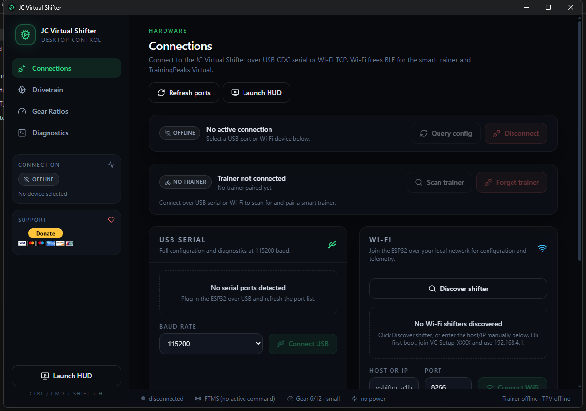
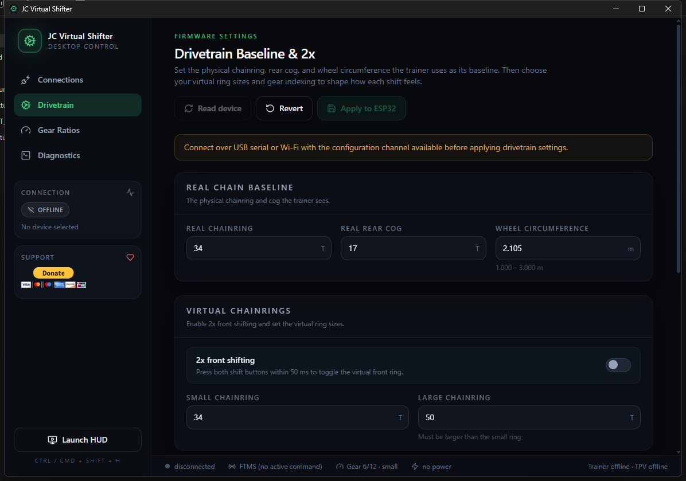
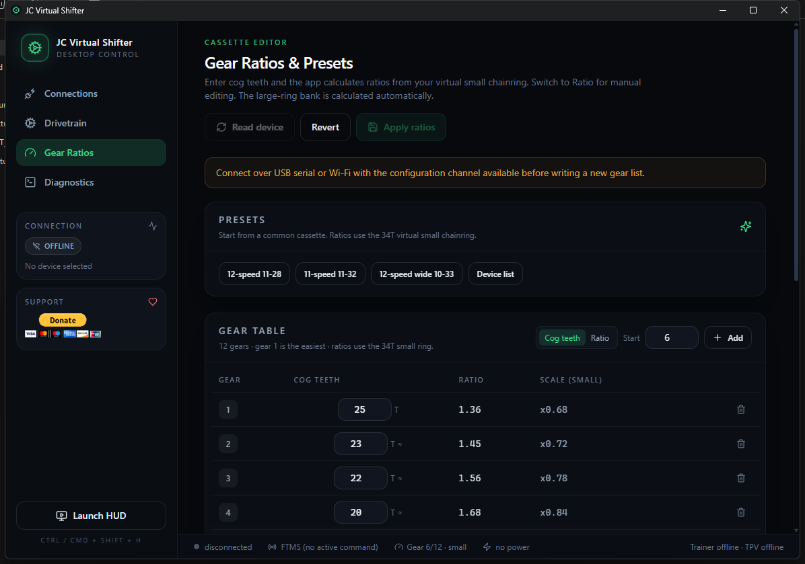
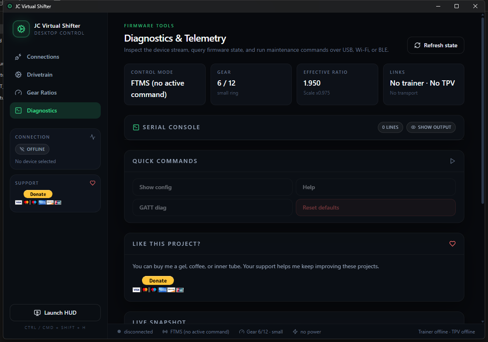
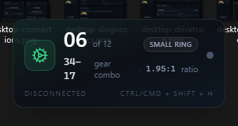

# JC Virtual Shifter

**Virtual shifting for your indoor trainer.** JC Virtual Shifter sits between a Bluetooth LE smart trainer and your indoor cycling app — such as TrainingPeaks Virtual, Zwift, MyWhoosh, or Rouvy — and adds handlebar shift buttons plus a configurable virtual drivetrain.

Shift up to make pedalling harder, shift down to make it easier, even on a trainer with no physical gears. A small desktop app handles setup, diagnostics, and an always-on-top HUD.

[Getting started](docs/getting-started.md) · [Wiring](docs/wiring.md) · [Flashing](docs/flashing.md) · [Desktop app](docs/desktop-app.md) · [Troubleshooting](docs/troubleshooting.md) · [Fair use](FAIR_USE.md)

---

## About this repository

This repository is the **public support and download home** for JC Virtual Shifter. It contains user documentation, release notes, and links to official download assets. It does **not** contain firmware or desktop application source code.

Official builds are published on the [Releases page](../../releases). New releases after v0.1.1 include:

- one `JC-Virtual-Shifter-<version>.zip` containing the desktop installers, firmware images, and compliance files in clearly named folders,
- a `SHA256SUMS.txt` file and a detached signature for that ZIP,
- the release public key used to check the signature,
- a release manifest inside the ZIP with version and build identifier.

See [Verifying downloads](#verifying-downloads) below.

### Like this Project?

You can buy me a gel, coffee, or inner tube. Your support helps me further develop on these types of projects.

[](https://www.paypal.com/cgi-bin/webscr?cmd=_s-xclick&hosted_button_id=RE2GQDK8CD2WW)

---

## How it works

The shifter connects to your smart trainer over Bluetooth LE and presents itself to your riding app as a standard FTMS trainer with power, cadence, and controllable resistance. The desktop app connects over USB or Wi-Fi for setup and telemetry, and the two handlebar buttons select a virtual gear. Measured power is passed through unchanged; only resistance and simulation commands are scaled by the active gear.

## What you get

- **Discrete virtual gears** — gear 1 is the easiest, the highest gear is the hardest, and Shift Up makes pedalling harder.
- **2x virtual front derailleur** — press both shift buttons within 50 ms to toggle between a small and large virtual chainring.
- **Physical shift buttons** — two momentary switches wired directly to the ESP32, with software debouncing.
- **Works in ERG and SIM modes** — gears change resistance and simulated grade in SIM mode; ERG target power stays under your app's control.
- **USB and Wi-Fi control** — USB for first-time setup, or Wi-Fi for a cable-free ride while Bluetooth stays dedicated to the trainer and riding app.
- **Persistent settings** — drivetrain settings and the paired trainer are saved across power cycles.
- **Desktop app** — configure the drivetrain, build a virtual cassette, inspect live telemetry, and run a floating HUD over your ride.

---

## What you need

| Item | Notes |
| :--- | :--- |
| ESP32 development board | ESP32-WROOM-32, ESP32-S3, or ESP32-C3. See [supported boards](#supported-boards). |
| 2 momentary push buttons | Tactile switches, bar-end clickers, or paddle shifters. |
| USB cable | Data-capable cable for flashing and first-time setup. |
| 5 V power | USB power is sufficient. |
| Bluetooth LE smart trainer | FTMS or FE-C control is required for virtual resistance. |
| Computer | Windows or macOS for the desktop app. |

A power-only trainer can still report power and cadence, but gears will not change resistance.

### Trainer compatibility

- **FTMS trainers** — resistance and simulation commands are scaled by the active virtual gear.
- **FE-C trainers** — supported through the BLE-carried FE-C service, including wind and track resistance.
- **Power-only trainers** — power and cadence can be forwarded, but there is no resistance control to scale. Gears will not change effort.

Pair the trainer in the desktop app first. The app highlights devices that advertise FTMS or FE-C.

### Riding app compatibility

JC Virtual Shifter works with riding apps that can pair a standard Bluetooth LE FTMS trainer or power meter, including TrainingPeaks Virtual, Zwift, MyWhoosh, and Rouvy. No app-specific plugin or driver is required.

- The app must use Bluetooth LE. Apps that only support ANT+ FE-C will not see the shifter.
- Gear changes are felt in SIM/route mode, where the app sends grade and resistance commands.
- ERG workouts stay under the app's target-power control.
- In firmware output and some parts of the desktop app, the connected riding app is labelled **TPV**. That is a legacy label and applies to whichever app is connected.

---

## Supported boards

Download the release ZIP from the [latest release](../../releases/latest), extract it, then choose the matching folder under `Firmware/`. In v0.1.1 and earlier, the firmware images are individual release assets with these same suffixes.

| Folder suffix | Board | Shift Up | Shift Down |
| :--- | :--- | :--- | :--- |
| `esp32-wroom` | ESP32-WROOM-32 / classic DevKit | GPIO 18 | GPIO 5 |
| `esp32-s3-zero` | Waveshare ESP32-S3 Zero | GPIO 4 | GPIO 5 |
| `esp32-c3-mini` | LOLIN C3 Mini | GPIO 7 | GPIO 5 |

The pins above are built into the official images. No code edits are needed. See [wiring](docs/wiring.md) for LED pins, strapping-pin cautions, and assembly notes.

---

## Quick start

1. **Wire two buttons** to the pins for your board. See [wiring](docs/wiring.md).
2. **Download and verify** the release ZIP from [Releases](../../releases/latest), then extract it.
3. **Install the desktop app** from `Desktop/Windows` or `Desktop/macOS`. See [desktop app](docs/desktop-app.md).
4. **Flash the firmware** from the matching `Firmware/` folder with the desktop app. See [flashing](docs/flashing.md).
5. **Connect over USB**, scan for your trainer, and pair it in the app.
6. **Pair the shifter in your riding app** as both power source and controllable trainer.
7. **Ride and shift.** Gear 1 is the easiest; Shift Up makes pedalling harder.

Pressing both buttons within 50 ms toggles the virtual front chainring when 2x front shifting is enabled.

---

## Verifying downloads

For new releases, download the release ZIP, `SHA256SUMS.txt`, `SHA256SUMS.txt.sig`, and `JC-Virtual-Shifter-release-public.asc` into the same folder. Verify the ZIP **before** extracting it.

For v0.1.1 and earlier, `SHA256SUMS.txt` lists the individual assets instead. Download the files you need plus the checksum, signature, and public key, then run the same commands from that folder.

**Windows (PowerShell):**

```powershell
Get-FileHash .\JC-Virtual-Shifter-<version>.zip -Algorithm SHA256
Get-Content .\SHA256SUMS.txt
```

Compare the hash printed by PowerShell with the hash in `SHA256SUMS.txt`.

**macOS / Linux:**

```bash
gpg --import JC-Virtual-Shifter-release-public.asc
gpg --verify SHA256SUMS.txt.sig SHA256SUMS.txt
shasum -a 256 -c SHA256SUMS.txt
```

For bundled releases, `SHA256SUMS.txt` contains the hash of the ZIP, so it must be checked before extraction. The release public key and its fingerprint are published with the release. Confirm the fingerprint shown by `gpg --verify` matches the one in the release notes. A matching hash confirms the downloaded file has not changed; the signature confirms it was produced by the release maintainer. Neither proves anything about firmware running on a board that someone else has flashed.

---

## Desktop app

The desktop app connects over USB serial, Wi-Fi, or Bluetooth LE setup and provides:

- trainer scanning and pairing,
- drivetrain and virtual cassette configuration,
- live diagnostics,
- an always-on-top HUD showing gear, ratio, and connection state.

The screenshots below show a fresh install before a device is connected.

### Connections

Use this page to connect over USB, discover a shifter over Wi-Fi, scan for your trainer, and launch the HUD.



### Drivetrain

Set the physical chainring and cog baseline, wheel circumference, virtual chainrings, and 2x front shifting here.



### Gear Ratios & Presets

Pick a cassette preset or edit cog teeth and ratios. Gear 1 is always the easiest.



### Diagnostics & Telemetry

Check control mode, gear, ratio, power, cadence, and connection state, or run maintenance commands.



### HUD

The always-on-top overlay shows the current gear, ring, ratio, and connection state while you ride.



Installers are currently **unsigned**. Windows SmartScreen and macOS Gatekeeper may warn on first launch; see [troubleshooting](docs/troubleshooting.md#installer-warnings).

---

## Riding with your training app

1. Wake the trainer and disconnect it from phones or other apps.
2. Confirm the desktop app shows the trainer as connected.
3. Pair the shifter in your riding app as power source and controllable trainer.
4. Start a ride.

In SIM/route mode, changing gear changes the resistance you feel. In ERG mode, your app keeps control of target power. Pair the trainer with the shifter only — if the riding app also connects directly to the trainer, the control link can be lost.

---

## Fair use

Official builds forward measured trainer power without multiplying it. Modified firmware is unsupported and may violate the rules of a riding platform or event. See [FAIR_USE.md](FAIR_USE.md).

---

## Support and security

- Questions and bug reports: [Issues](../../issues)
- Security reports: [SECURITY.md](SECURITY.md) — please do not open a public issue.
- Privacy: [PRIVACY.md](PRIVACY.md)

---

## License

Documentation and distributed binaries are provided under the terms in [LICENSE.md](LICENSE.md). Third-party components are listed in [THIRD_PARTY_NOTICES.md](THIRD_PARTY_NOTICES.md), with full license texts in [`licenses/`](licenses/).
