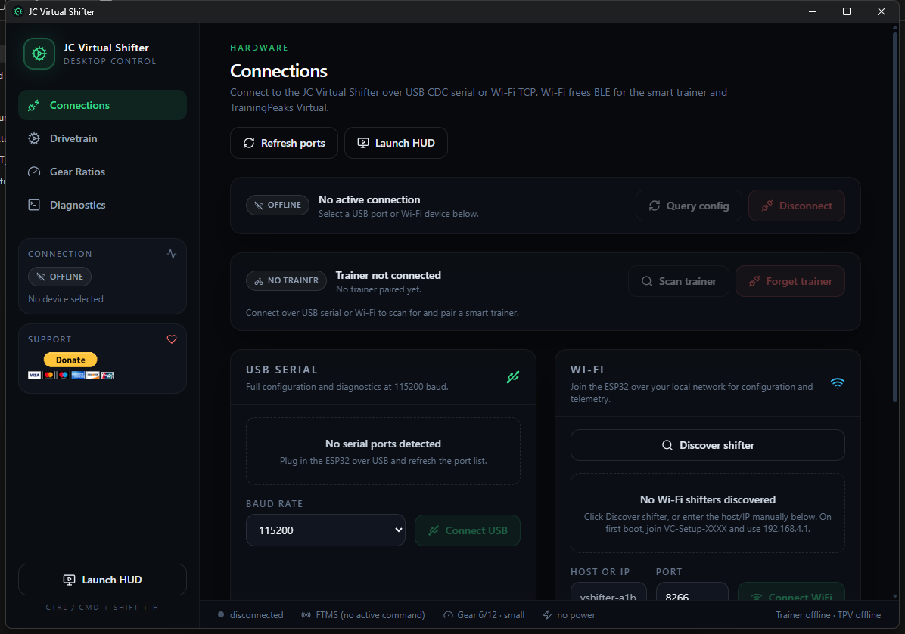
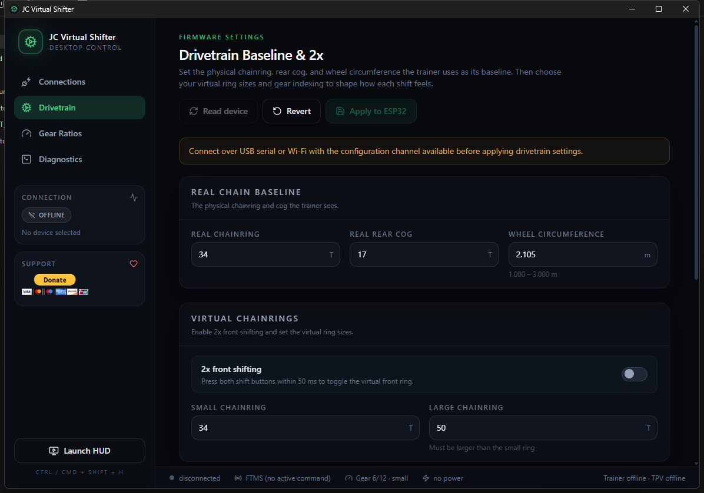
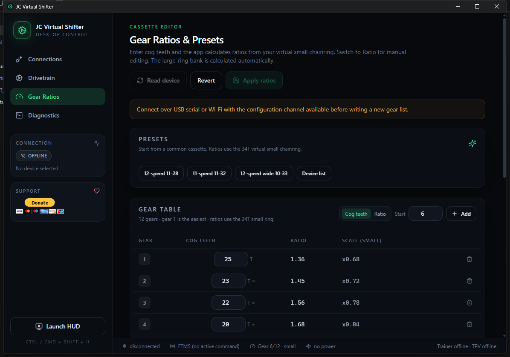
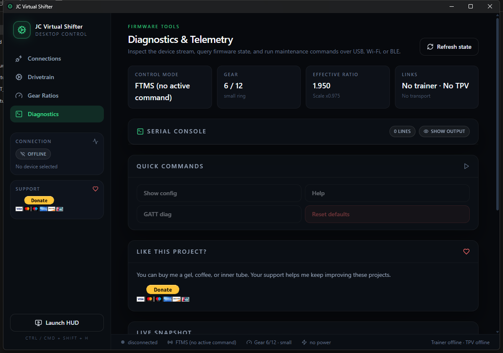
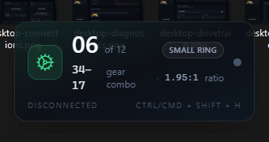

# Desktop app

The desktop app configures the shifter, shows live telemetry, and provides an always-on-top HUD. It runs on Windows and macOS.

## Install

Download the Windows or macOS installer from the [latest release](../../releases/latest). Current installers are unsigned; see [installer warnings](troubleshooting.md#installer-warnings).

The app uses USB serial, Wi-Fi, and Bluetooth LE locally. See [PRIVACY.md](../PRIVACY.md).

## First connection

1. Plug the ESP32 into a USB port with a data-capable cable.
2. Open **Connections** and select the ESP32's serial port.
3. Click **Connect USB** and wait for the device card to show **Device connected**.
4. In the **Trainer** card, click **Scan trainer**, then **Connect** next to your trainer.
5. Confirm the trainer card shows **Trainer connected**.

If your trainer does not appear, click **Show all BLE devices**. Some trainers do not advertise FTMS or FE-C until they are awake or disconnected from another app.

## Wi-Fi setup

Wi-Fi is optional. Use **Connections → Wi-Fi → Set up over Bluetooth** to hand credentials to the shifter, then connect over the network.

- The shifter uses 2.4 GHz Wi-Fi only and works best with WPA2-PSK.
- WPA3-only, enterprise, and client-isolated networks may not work.
- On first boot, an open setup network named `VC-Setup-XXXX` is available at `192.168.4.1` on port 8266.
- You can also enter a hostname such as `vshifter-a1b2.local`, port 8266, or the device IP address.

Allow the app through the Windows firewall when prompted. On macOS 15 or later, allow it under **System Settings → Privacy & Security → Local Network**.

## Pages

### Connections

Connect over USB or Wi-Fi, discover shifters on the network, scan and pair a trainer, forget a saved trainer, check link status, and launch the HUD.

### Drivetrain

Set the physical chainring and cog baseline, wheel circumference, virtual chainrings, 2x front shifting, gear count, and start gear. Click **Apply to ESP32** to save.

### Gear Ratios & Presets

Build the virtual cassette from a preset or from individual cog teeth or ratios. Up to 16 gears are supported. Gear 1 is always the easiest. The app validates the list before writing it to the shifter.

### Diagnostics & Telemetry

View control mode, gear, front ring, effective ratio, connection status, power, cadence, speed, firmware version, and chip family. The diagnostic console provides maintenance commands such as reading state and resetting drivetrain defaults.

### HUD

A small always-on-top overlay showing gear, gear count, ring, ratio, and connection state.

- Toggle with **Ctrl + Shift + H** (Windows) or **Cmd + Shift + H** (macOS).
- Press Escape or use the on-screen controls to return to settings.
- The system tray also offers **Restore Settings**, **Toggle HUD**, and **Quit**.

The HUD reads from the active app connection, so keep the desktop app connected over USB or Wi-Fi while riding.
